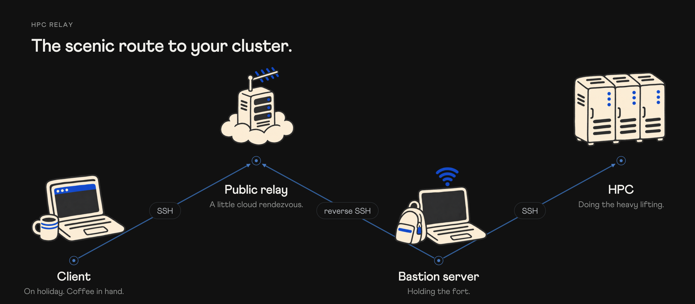

# Pogo



You're away from campus, perhaps on holiday with a coffee in hand, while a long
experiment runs on the university cluster. You want to see how it's doing, but
the cluster is only reachable from the campus network. A spare Linux laptop
stays there as your bastion server, holding the fort while you take your own
machine with you.

Pogo makes that connection possible with an outbound reverse SSH tunnel from the
bastion to a small public relay. From wherever you are, `ssh hpc` takes you through
the relay and the bastion to the cluster. You can check a job, collect results, or
submit the next run. The compute stays on the cluster, and your private
destination key stays on your client. Your coffee gets to stay with you, too.

Pogo was built for a setup at **NIT Jalandhar (NITJ)**, where campus Wi-Fi uses a
captive portal for internet access. The optional login script targets the Sophos
portal used in that setup. If your college uses a different portal, you may need
to adapt the script or write your own adapter. If there is no portal, leave the
helper disabled. The reverse SSH tunnel works independently of the portal helper.

The same approach can work for a lab workstation or a home server behind NAT.
You need a bastion that can reach the private host and make an outbound SSH
connection to the relay. Pogo packages the tunnel, Wi-Fi recovery, and status
page for the Ubuntu setup below.

## What's included

- A reverse SSH tunnel with a loopback-only listener, pinned host keys, and automatic retries.
- A NetworkManager watchdog that reconnects a saved Wi-Fi profile.
- An optional adapter for NITJ's Sophos mode `451` captive portal, with a shared login rate limit.
- A small status page with probe history and optional Resend email alerts.
- Separate, optional helpers for GDM autologin and a limited dracut/LUKS boot setup.

## Supported setup

| Part | Requirements |
|---|---|
| Public relay | Dedicated Ubuntu 24.04 VM, OpenSSH server, systemd, Python 3.11+ |
| Bastion server | Ubuntu 24.04, systemd, OpenSSH server, NetworkManager managing Wi-Fi |
| Client | macOS or Linux with Bash and OpenSSH. Windows users can use WSL. |
| Private destination | An SSH host reachable from the bastion |
| Captive portal | Optional adapter for the NITJ/Sophos `/userportal/Controller` flow, mode `451` |

The documented bastion is a campus laptop. Other networks or Linux distributions
may need changes, and other captive portals need their own adapter. You need
permission to use the network and destination account, and the network must allow
outbound SSH. Any suitable Ubuntu VM with a stable public address can be the
relay, including one hosted outside AWS.

## Set it up

Start with the [setup guide](docs/setup.md). The
[configuration checklist](docs/configuration.md) lists every value you need to
supply, including the four placeholders in the client SSH snippet. Keep your
actual values in a private copy of the [deployment worksheet](docs/this-deployment.md).

The files in [`config/`](config/) are examples. Copy and edit them for your
machines before installing. The installers replace internal template markers
automatically. For other campus networks, read the
[portal adapter notes](docs/setup.md#adapting-the-portal-helper) and
[network-specific settings](docs/configuration.md#other-campus-and-network-settings).

For details about the SSH path and recovery behavior, read the
[design notes](docs/design.md). The [operations guide](docs/operations.md) covers
health checks, maintenance, and recovery.

## Try the status page


*A healthy tunnel, shown with sample monitoring data.*

You can preview the design locally with sample data:

```bash
python3 relay/bin/tunnel-status-web.py --preview up
```

Open [localhost:8080](http://127.0.0.1:8080/). Use `--preview down` to see an unavailable
tunnel. Preview mode needs no root access and does not probe a tunnel, send email,
or write history.

The page works with system fonts. Athletics is optional and is not distributed
here. Supply the font files only if you have the right to use them.

## Security and limits

The reverse listener binds to localhost on the relay. Its dedicated tunnel account
can open only the configured reverse port. It has no shell, SFTP, agent forwarding,
or local forwarding. Your private destination key stays on the client, so you do
not need agent forwarding.

The status page checks the **bastion's SSH banner**. It does not check the cluster,
your jobs, or your client's connection. Uptime percentages describe recorded
checks, rather than an SLA. Missing checks do not count as up, and a probe older
than 90 seconds becomes unknown.

For public HTTPS, put the HTTP origin behind a reverse proxy and bind it to
loopback. The [HTTPS instructions](docs/setup.md#https) include an example. The
status page and its API are public, without authentication. The supplied Python
server is intended for a small status page.

The tunnel starts without a desktop login once Linux services and networking are
available. Automatic disk unlock and GDM autologin are separate opt-ins with
physical-access tradeoffs. Read the boot section of the setup guide before using
those helpers.

## Development

Runtime Python code uses the standard library. Tests use synthetic data and do
not contact AWS, a portal, Resend, or the cluster:

```bash
python3 -m unittest discover -s tests -v
```

For the full checks, install ShellCheck and the dependencies in
[`requirements-dev.txt`](requirements-dev.txt), then run `scripts/check.sh`.
CI is configured for Python 3.11, 3.12, and 3.14 on Ubuntu. See the
[contribution guide](CONTRIBUTING.md) for details.

## License

[MIT](LICENSE). Keep private keys, real credentials, local deployment notes, and
proprietary font files out of a public copy. Use the ignored `.local/` directory
for private records, and review the files you publish even when ignore rules are
in place.
